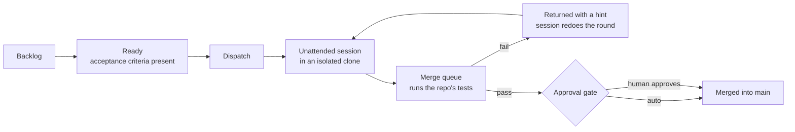
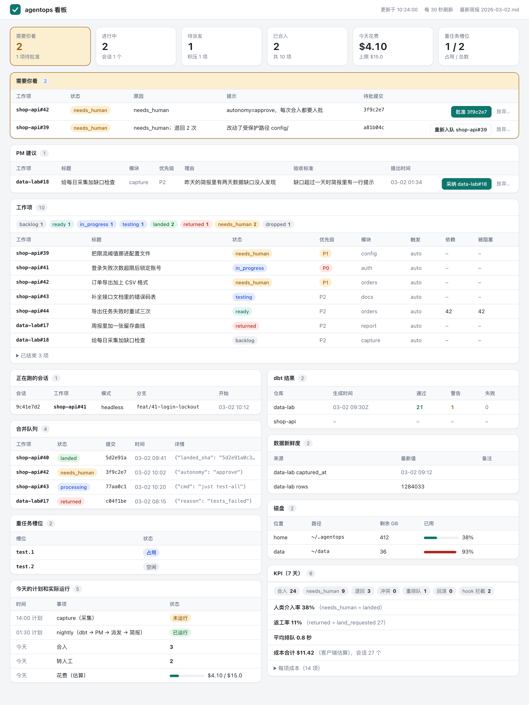

# backlogzero

**AI agents work your backlog down to zero. You just approve.**

English | [简体中文](README.zh-CN.md)

backlogzero is a local pipeline for running coding agents unattended on your own repositories. You write work items with explicit acceptance criteria. The pipeline picks the ready ones, starts an agent session for each in its own isolated clone, runs the tests in a merge queue, and stops at an approval gate before anything reaches `main`.

## What problem it solves

Running one coding agent in a terminal is easy. Running several on a real backlog is not: they step on each other's working trees, edit the tests until they pass, merge things nobody looked at, and leave you with no record of what happened. backlogzero puts rails around that:

- **One work item, one session, one clone.** Each session gets its own clone and branch and can only write there.
- **Tests are append-only for agents.** A hook blocks edits to existing tests and to protected paths (configuration, hooks, lockfiles); a session that needs to change a test has to stop and say so.
- **A merge queue owns the verdict.** The session asks to land; the queue runs the repository's own test recipe, and only that result counts.
- **Approval gates.** Per repository you choose whether merges are automatic or need a human. Approvals are bound to the exact commit that was queued, and can't be given from inside a session.
- **Everything is logged.** Work-item transitions, sessions, queue runs and hook blocks go to an append-only event log, and `ao kpi` summarizes it (human-intervention rate, rework rate, queue time, cost).

## How it works



A work item is a Markdown file with front matter (`repo`, `type`, `priority`, `depends_on`, `acceptance`, …). The state machine is `backlog → ready → in_progress → queued → testing → landed`, with side exits to `returned`, `needs_human` and `dropped`. A work item cannot become `ready` without at least one acceptance entry.

## The board

`ao board` serves a local, auto-refreshing page (it listens on `127.0.0.1` only). It shows what needs you, and it is where approvals happen.

<picture>
  <source media="(prefers-color-scheme: dark)" srcset="docs/images/board-dark.png">
  
</picture>

The screenshot uses made-up data: the repositories and work items in it do not exist. The interface text is currently Chinese. From top to bottom:

- **Summary tiles.** How many items need you, how many are in progress or ready, how many have landed, today's spend against the daily budget, and how many heavy-task slots are in use.
- **Needs you (需要你看).** Items waiting on a human, each with the reason. 批准 approves the exact commit shown, 重新入队 puts an item back in the queue, and 放弃… drops it after a second confirmation.
- **PM proposals (PM 建议).** Backlog items proposed by the PM step that wait for your decision: adopt or drop.
- **Work items (工作项).** Open items with status, priority, module and dependencies; finished ones are folded away.
- **Operational panels.** Running sessions, the merge queue, heavy-task slots, today's schedule and spend, dbt results, data freshness, disk, and 7-day KPIs.

To regenerate the screenshot after a UI change, see `tools/board_demo.py`.

## Naming

The repository is called **backlogzero**. The command-line tool is **`ao`**, the Python package is **`agentops`**, and runtime state lives in **`~/.agentops`** (override with `AGENTOPS_HOME`). Those names predate the public name and are unchanged.

This project is not affiliated with the company AgentOps or its `agentops` package on PyPI, and it is not published to PyPI. Install it from a clone, as below.

## Quick start

Requirements: macOS, Python 3.12, `git`, `jq`, [`just`](https://github.com/casey/just), [`uv`](https://github.com/astral-sh/uv), `duckdb`, and the [Claude Code](https://code.claude.com) CLI (`claude`) for running sessions.

```bash
git clone https://github.com/r2m-ai/backlogzero
cd backlogzero
just sync       # create .venv with uv
just check      # ruff + pytest
just install    # install `ao` to ~/.local/bin (editable install)
ao doctor       # check tools, auth, state directory
```

Create the state directory and a first work item. To try this without touching your real state, point `AGENTOPS_HOME` at a scratch directory first:

```bash
export AGENTOPS_HOME="$(mktemp -d)/agentops-home"
mkdir -p "$AGENTOPS_HOME"
ao init
ao wi new --repo quant-lab --title "Add a monthly rebalance test" \
  --type feat --priority P1 \
  --acceptance "tests cover monthly rebalance" --body "Example spec."
ao wi ready quant-lab#1     # refused if acceptance is empty
ao wi list
ao kpi
ao queue
```

(`quant-lab` is just the repository name that the default `config.toml` ships with; register your own repositories as shown below.)

Attach one of your own repositories and let the pipeline work it:

```bash
ao repo init ~/work/<repo> --name <repo>   # copies templates, installs git hooks
# register it in ~/.agentops/config.toml:   [repos]  <repo> = "~/work/<repo>"
ao wi new --repo <repo> --title "..." --acceptance "..." --ready
ao start <repo>#<id> --headless            # unattended session in its own clone
ao steward --once                          # process the merge queue
ao board                                   # local dashboard on 127.0.0.1:8749
```

Each repository needs a `justfile` providing the recipes the pipeline calls (`test-fast`, `test-all`, `capture`, `nightly`) and a `.pipeline.toml` for settings such as `autonomy` and protected paths. See the [manual](docs/manual.md) and the [runbook](docs/runbook.md) for details, including the `launchd` jobs for the steward, board and nightly runs.

> **Verification note.** `ao init`, `ao doctor`, `ao wi new/ready/list`, `ao kpi` and `ao queue` were run against a clean temporary `AGENTOPS_HOME`. `just sync`, `just install`, `ao repo init`, `ao start`, `ao steward` and `ao launchd ...` modify your machine or launch sessions and are written here from the `justfile` and the code, not run for this README.

## What it has been used for

It runs on its own repository and on a few private ones, none of them public yet:

- a quantitative research repository
- a data-collection repository
- a repository of collector combinations

No results from those projects are published here.

## Origin

The approach draws on publicly shared experience with multi-session development pipelines; the code is written from scratch for this project.

## Known limitations

- **macOS only.** It relies on `launchd`, the macOS keychain, and the macOS sandbox for sessions.
- **Built around Claude Code.** Unattended Codex sessions are supported but more limited: headless only, and a returned work item is not redone automatically.
- **Single user, local machine.** No multi-user access control; the board listens on `127.0.0.1` only.
- **Not a security boundary.** The guards (hooks, protected paths, sandbox) reduce mistakes; they are not a proof against a hostile agent.
- **Tests decide.** The pipeline is only as good as each repository's tests and acceptance criteria. Cost figures are client-side estimates.
- **Early software.** Version 0.1.0, not on PyPI, and the docs are partly in Chinese.

## Documentation

- [Manual](docs/manual.md) (Chinese): layout, commands, onboarding a repository, Codex runtime
- [Runbook](docs/runbook.md) (Chinese): install, per-command usage, troubleshooting, exporting a public snapshot
- [Claude CLI notes](docs/claude-cli.md), [Codex CLI notes](docs/codex-cli.md)

## License

[MIT](LICENSE), Copyright (c) 2026 r2m.ai.
