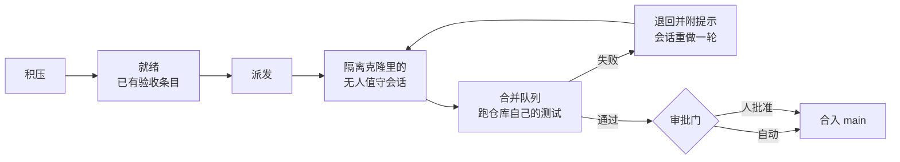
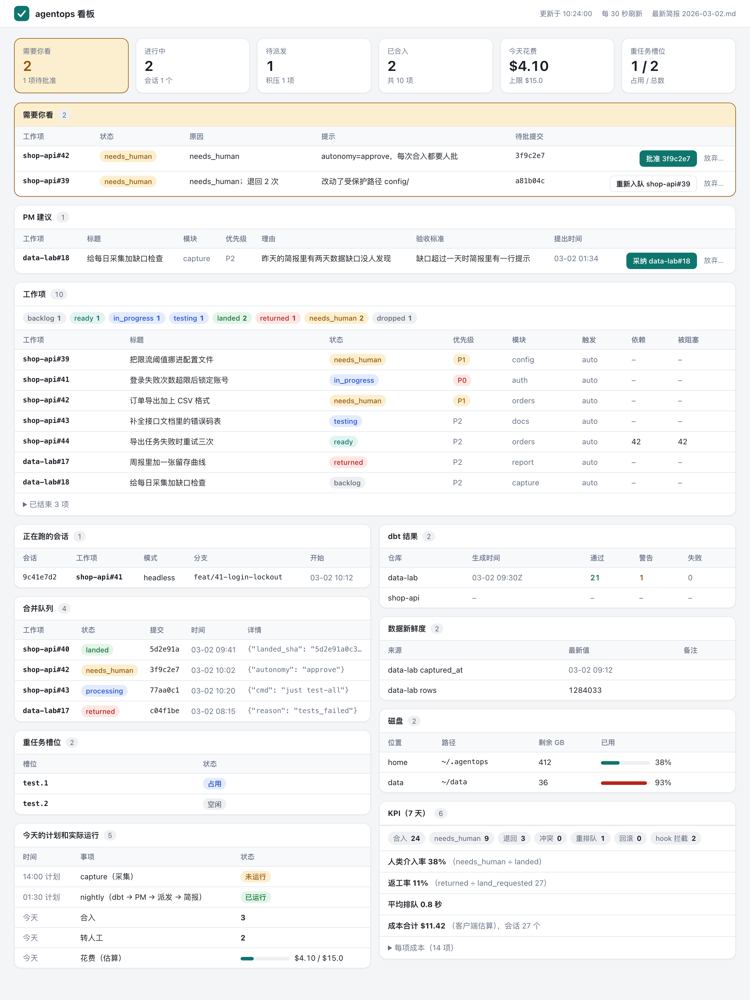

# backlogzero

**让 AI agent 把你的积压清零，你只负责批准。**

[English](README.md) | 简体中文

backlogzero 是一套本地流水线，让编码 agent 在你自己的仓库里无人值守地干活。你写好带验收条目的工作项；流水线挑出就绪的，为每一项在独立克隆里启动一个 agent 会话，由合并队列跑测试，最后在审批门停下，人批准后才进入 `main`。

## 它解决什么问题

在终端里跑一个编码 agent 很容易，在真实的积压上同时跑好几个就不容易了：它们互相踩工作区，改测试来让测试通过，合入没人看过的东西，事后也查不到发生了什么。backlogzero 给这些事加上护栏：

- **一项一会话一克隆。** 每个会话有自己的克隆和分支，只能写那里。
- **agent 只能新增测试。** 钩子会拦下对已有测试和受保护路径（配置、钩子、锁文件）的修改；需要改测试的会话必须停下并说明。
- **合并队列说了算。** 会话只是申请合入；队列跑仓库自己的测试，只认这个结果。
- **审批门。** 每个仓库自己选合并是自动还是要人批。审批绑定入队时的那个提交，且无法在会话内给出。
- **全程留痕。** 工作项流转、会话、队列运行、钩子拦截都进追加写的事件日志，`ao kpi` 从中汇总（人类介入率、返工率、排队时间、成本）。

## 工作方式



工作项是带 front matter 的 Markdown 文件（`repo`、`type`、`priority`、`depends_on`、`acceptance` 等）。状态机为 `backlog → ready → in_progress → queued → testing → landed`，另有 `returned`、`needs_human`、`dropped` 分支。验收条目为空的工作项进不了 `ready`。

## 看板

`ao board` 在本机起一个自动刷新的页面（只监听 `127.0.0.1`）。需要你处理的事情在这里看，审批也在这里做。

<picture>
  <source media="(prefers-color-scheme: dark)" srcset="docs/images/board-dark.png">
  
</picture>

截图里的数据是虚构的，里面的仓库和工作项都不存在。从上到下：

- **统计块。** 有几项需要你看、几项进行中或待派发、已合入多少、今天的花费和每日预算、重任务槽位占用了几个。
- **需要你看。** 等人处理的工作项和原因。“批准”只对显示的那个提交生效，“重新入队”把工作项放回队列，“放弃…”要二次确认。
- **PM 建议。** PM 环节提出、等你决定的积压项，可以采纳或放弃。
- **工作项。** 未结束的列出状态、优先级、模块和依赖；已结束的折叠起来。
- **运行面板。** 正在跑的会话、合并队列、重任务槽位、今天的计划和花费、dbt 结果、数据新鲜度、磁盘、7 天 KPI。

界面改动后重新生成截图的办法见 `tools/board_demo.py`。

## 命名

仓库叫 **backlogzero**，命令行叫 **`ao`**，Python 包名是 **`agentops`**，状态目录是 **`~/.agentops`**（可用 `AGENTOPS_HOME` 改位置）。这些名字早于公开名，没有改动。

本项目与 AgentOps 公司及其在 PyPI 上的 `agentops` 包无关，也没有发布到 PyPI，请从克隆安装，见下。

## 快速开始

环境：macOS、Python 3.12、`git`、`jq`、[`just`](https://github.com/casey/just)、[`uv`](https://github.com/astral-sh/uv)、`duckdb`，以及运行会话用的 [Claude Code](https://code.claude.com) CLI（`claude`）。

```bash
git clone https://github.com/r2m-ai/backlogzero
cd backlogzero
just sync       # 用 uv 建 .venv
just check      # ruff + pytest
just install    # 把 ao 装到 ~/.local/bin（可编辑安装）
ao doctor       # 检查工具、认证、状态目录
```

建状态目录和第一个工作项。想不碰真实状态试一试，先把 `AGENTOPS_HOME` 指到临时目录：

```bash
export AGENTOPS_HOME="$(mktemp -d)/agentops-home"
mkdir -p "$AGENTOPS_HOME"
ao init
ao wi new --repo quant-lab --title "Add a monthly rebalance test" \
  --type feat --priority P1 \
  --acceptance "tests cover monthly rebalance" --body "Example spec."
ao wi ready quant-lab#1     # 验收条目为空会被拒
ao wi list
ao kpi
ao queue
```

（`quant-lab` 只是默认 `config.toml` 自带的仓库名；你自己的仓库按下面的方式登记。）

接入你自己的仓库并让流水线干活：

```bash
ao repo init ~/work/<repo> --name <repo>   # 复制模板、装 git 钩子
# 在 ~/.agentops/config.toml 登记：  [repos]  <repo> = "~/work/<repo>"
ao wi new --repo <repo> --title "..." --acceptance "..." --ready
ao start <repo>#<id> --headless            # 在独立克隆里启动无人值守会话
ao steward --once                          # 处理一轮合并队列
ao board                                   # 本地看板，127.0.0.1:8749
```

每个仓库需要一个 `justfile`，提供流水线调用的 recipe（`test-fast`、`test-all`、`capture`、`nightly`），以及配置 `autonomy`、受保护路径等的 `.pipeline.toml`。详见[使用手册](docs/manual.md)和[运维手册](docs/runbook.md)，包括 steward、看板和夜间任务的 `launchd` 配置。

> **验证说明。** `ao init`、`ao doctor`、`ao wi new/ready/list`、`ao kpi`、`ao queue` 已在干净的临时 `AGENTOPS_HOME` 下实际跑过。`just sync`、`just install`、`ao repo init`、`ao start`、`ao steward`、`ao launchd ...` 会改动本机或启动会话，这里是对照 `justfile` 和代码写的，没有为本 README 实际运行。

## 用它做出的项目

它在自己的仓库和几个私有仓库上运行，这些仓库尚未公开：

- 一个量化研究仓库
- 一个数据采集仓库
- 一个采集器组合仓库

这里不发布这些项目的任何结果。

## 来源

做法参考了公开分享的多会话研发流水线经验，代码为自建。

## 已知局限

- **仅 macOS。** 依赖 `launchd`、macOS 钥匙串和会话的 macOS 沙箱。
- **以 Claude Code 为主。** 支持无人值守的 Codex 会话，但能力有限：只能 headless，被退回的工作项不会自动重做。
- **单用户、本机。** 没有多用户权限控制；看板只监听 `127.0.0.1`。
- **不是安全边界。** 钩子、受保护路径、沙箱能减少失误，不能防住恶意 agent。
- **测试说了算。** 流水线的质量取决于各仓库的测试和验收条目。成本数字是客户端估算。
- **早期软件。** 版本 0.1.0，未上 PyPI，文档部分仍是中文。

## 文档

- [使用手册](docs/manual.md)：布局、命令、接入仓库、Codex 运行时
- [运维手册](docs/runbook.md)：安装、各命令用法、排错、导出公开快照
- [Claude CLI 实测记录](docs/claude-cli.md)、[Codex CLI 实测记录](docs/codex-cli.md)

## 许可证

[MIT](LICENSE)，Copyright (c) 2026 r2m.ai。
